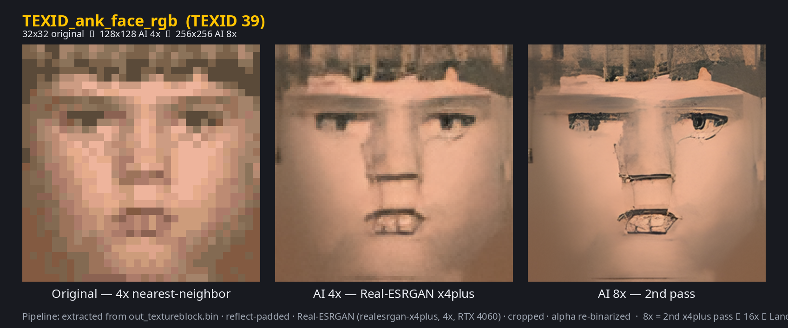
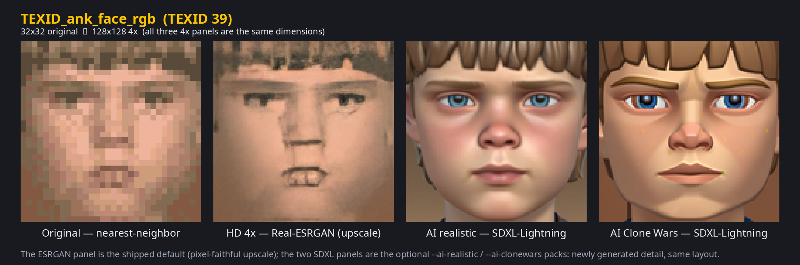

# SWRacer Enhance Mod

All-in-one enhancement mod for **Star Wars Episode I Racer** (Steam/GOG). It merges these
third-party projects with AI-generated HD textures:

- **SW_RACER_RE** v0.17 — tim-tim707, louriccia & contributors · AGPL-3.0 — renderer (`dinput.dll`), shaders, HD fonts, glTF, custom tracks, menus
- **DSOAL** — kcat (Chris Robinson) · LGPL-2.1 — 3D/HRTF audio
- **Starfighter's Audio Overhaul** — Starfighter · HD engine sounds
- **"Dead Simple 2026" fix pack** — superrast / Rast1234 · maxed game configs
- **swe1r_Smush** — Jérémy Ansel · MIT — `Smush.cfg` (cutscene aspect)
- **Real-ESRGAN** — Xintao Wang et al. · BSD-3-Clause — HD texture upscaling
- **SDXL-Lightning** / **controlnet-tile-sdxl-1.0** — ByteDance / xinsir · OpenRAIL++ / Apache-2.0 — optional AI-texture packs
- optional extras: **dgVoodoo2** (Dege), **Xidi** (Samuel Grossman) · BSD-3-Clause, **ReShade** + **SweetFX**

Authors, links and full license texts: [`SWRacerEnhanceMod/ATTRIBUTION.md`](SWRacerEnhanceMod/ATTRIBUTION.md).

## Preview

One texture, Anakin's 32×32 face (`TEXID_ank_face_rgb`): **original** pixels scaled up with
nearest-neighbor, the shipped **Real-ESRGAN 4×**, and the optional **8×** pass.



The optional AI packs *generate* new detail instead of upscaling it — **original | 4× |
AI realistic | AI Clone Wars**:



More sheets: [`docs/comparisons/`](docs/comparisons/) (upscales) and
[`docs/comparisons/ai/`](docs/comparisons/ai/) (AI packs).

## Layout

```
SWRacerEnhanceMod/         ← copy this folder's contents into the game directory
  dinput.dll               community improvement mod v0.17 (new OpenGL renderer, F5 menu)
  assets/                  shaders, HD fonts, custom tracks, glTF support...
  assets/replacement_textures/   1633 AI-upscaled 4x HD textures (+ CATALOG.csv)
  dsound.dll, dsoal-aldrv.dll, alsoft.ini   DSOAL 3D audio (HRTF) from the fix guide
  data/config/current/     maxed-out graphics/audio/force-feedback configs
  data/wavs/, Sounds.map   higher-quality engine sounds
  Smush.cfg                cutscenes keep aspect ratio
  optional/                our extras + third-party fallbacks
  optional/hd_8x/         optional 8x AI textures (~358 MB; higher VRAM) + README      (--hd-8x)
  optional/ai_textures/   optional AI-regenerated textures (realistic/ + clonewars/)   (--ai-*)
  optional/ui_hd/         optional 2–4x HD menu/UI .TGAs, overlaid on data/images/     (--ui-hd)
  optional/reshade/       optional ReShade preset + helper (ReShade downloaded at install) (--reshade)
  optional/third_party/           dgVoodoo2 / Xidi (for NON-mod play only)
  ATTRIBUTION.md   every original mod: author, link, license, usage
  LICENSES/                upstream license texts (AGPL/LGPL/BSD/MIT) + notices
  README.md        full install + feature + provenance docs
  HD_TEXTURES_QA.md  vision-LLM quality review of the AI textures
  LICENSE          WTFPL v2 license for this project's own files
install.sh / install.bat   installers (back up every file they overwrite)
uninstall.sh / uninstall.bat   remove mod files and restore the backups
  (install.ps1 / uninstall.ps1 do the work on Windows)
change_textures.sh / .bat  switch texture pack after install (default/8x/realistic/clonewars/list)
LICENSE                    WTFPL v2 (this project's own files only)
tools/                     texture extractor + Real-ESRGAN pipeline (4x + optional 8x)
                           + generate_ai_textures.py (optional SDXL-regenerated packs)
```

## Documentation

Full index: [`docs/README.md`](docs/README.md) — texture comparisons, the
[Linux/Proton fix](docs/LINUX_PROTON.md) (**required** on Linux: without
`WINEDLLOVERRIDES="dinput=n,b"` F5 does nothing and no `hook.log` is created), and the
[texture pipeline deep-dive](docs/HD_TEXTURE_PIPELINE.md) (file formats, extraction, upscaler/regeneration
settings, QA). For FSR/NIS upscaling or ReShade, see
[upscaling, sharpening & "ray tracing"](docs/UPSCALING.md) (gamescope `-F fsr` is the Linux route;
DLSS and real ray tracing aren't possible on this renderer).

## Install

```bat
install.bat "C:\Program Files (x86)\Steam\steamapps\common\Star Wars Episode I Racer"
```

or copy everything inside `SWRacerEnhanceMod/` (except `optional/`) into the game folder manually.
In game, press **F5** for the community-mod menu. On Linux/Proton read
[`docs/LINUX_PROTON.md`](docs/LINUX_PROTON.md) first.

### Texture packs (optional)

The shipped HD pack is 4x Real-ESRGAN. Optional alternatives can be chosen at install time or
switched later:

| Pack | Flag | Notes |
|---|---|---|
| default 4x | — | shipped pack, 1633 textures |
| 8x | `--hd-8x` | second AI pass; ~1.5 GB VRAM worst-case |
| AI realistic | `--ai-realistic` | SDXL-Lightning, photoreal PBR; 1621 textures |
| AI Clone Wars | `--ai-clonewars` | SDXL-Lightning, stylised look; 1621 textures |

```bash
./install.sh --hd-8x     "/path/to/Star Wars Episode I Racer"   # or --ai-realistic / --ai-clonewars
```

Details: [`optional/hd_8x`](SWRacerEnhanceMod/optional/hd_8x/README.md) ·
[`optional/ai_textures`](SWRacerEnhanceMod/optional/ai_textures/README.md).

### Other optional extras

| Extra | Flag | Notes |
|---|---|---|
| HD menu/UI TGAs | `--ui-hd` | 92 upscaled `.TGA`s overlaid on `data/images/`; restore from backup if any looks off |
| ReShade | `--reshade` | downloads ReShade (as `opengl32.dll`) + the SweetFX shaders and drops in `SWRacer_Optimized.ini`; no ReShade binary/shader is bundled |

```bash
./install.sh --ui-hd --reshade "/path/to/Star Wars Episode I Racer"
```

Details: [`optional/ui_hd`](SWRacerEnhanceMod/optional/ui_hd/README.md) ·
[`optional/reshade`](SWRacerEnhanceMod/optional/reshade/README.md) ·
[upscaling guide](docs/UPSCALING.md).

## Switch texture pack later

Once installed, change the pack without re-running the installer:

```bash
./change_textures.sh list                 # packs + which is currently installed
./change_textures.sh default   "/path/..."   # default | 8x | realistic | clonewars
```

```bat
change_textures.bat realistic "C:\...\Star Wars Episode I Racer"
```

It re-lays the default 4x pack then overlays the chosen one (so the 12 logo/UI textures the AI packs
skip stay at 4x), and leaves the backup/manifest untouched — `uninstall.sh` still removes everything.

## Uninstall

The installers **back up every file they overwrite** into `<game>/.swracer_enhance_backup/` (with a
manifest), so the change is fully reversible:

```bat
uninstall.bat "C:\Program Files (x86)\Steam\steamapps\common\Star Wars Episode I Racer"
```
```bash
./uninstall.sh "/path/to/Star Wars Episode I Racer"
```

It deletes the files the mod added, restores the originals from the backup, then removes the backup
folder.

> **Note:** the Windows scripts (`install.bat`/`uninstall.bat`/`change_textures.bat` and their
> `.ps1`) are **untested**; only the Linux `*.sh` scripts have been run.

## Sources

Everything merged here — the SW_RACER_RE v0.17 community mod, the "Dead Simple 2026" Steam guide's
fix pack (DSOAL 3D audio, maxed configs, HD engine sounds), and the AI HD textures (Real-ESRGAN,
plus optional SDXL-regenerated packs) — is attributed with authors, links and licenses in
[`SWRacerEnhanceMod/ATTRIBUTION.md`](SWRacerEnhanceMod/ATTRIBUTION.md).

## Built with

This package and its tooling were assembled interactively with [**OpenCode**](https://opencode.ai) (the
open-source terminal coding agent), across its **v1** and
**v2** releases. Models used:

- **Coding agent:** **Big Pickle** (provider `opencode`) and **Claude Haiku 5.5**.
- **Texture upscaling:** Real-ESRGAN x4plus (`realesrgan-ncnn-vulkan`).
- **AI regeneration:** SDXL base + **SDXL-Lightning** 8-step UNet (ByteDance) with
  **xinsir/controlnet-tile-sdxl-1.0**, run locally via `diffusers`.
- **QA review:** Ollama vision models `qwen3.5:9b` and `gemma3:4b`.

Model licenses are listed in [`SWRacerEnhanceMod/ATTRIBUTION.md`](SWRacerEnhanceMod/ATTRIBUTION.md).

### Commit attribution

Commit-message and AI-attribution conventions live in [`CONTRIBUTING.md`](CONTRIBUTING.md)
(for contributors) and [`AGENTS.md`](AGENTS.md) (for coding agents).

## License

Our own files (`install.*`, `uninstall.*`, `change_textures.*`, `tools/*.py`, docs, comparison
images) are **WTFPL v2** — see [`LICENSE`](LICENSE). Bundled third-party components keep their own
licenses (SW_RACER_RE AGPL-3.0, DSOAL LGPL-2.1, Xidi BSD-3-Clause, dgVoodoo2 freeware; the textures
are derivatives of the game) — details in [`ATTRIBUTION.md`](SWRacerEnhanceMod/ATTRIBUTION.md).
