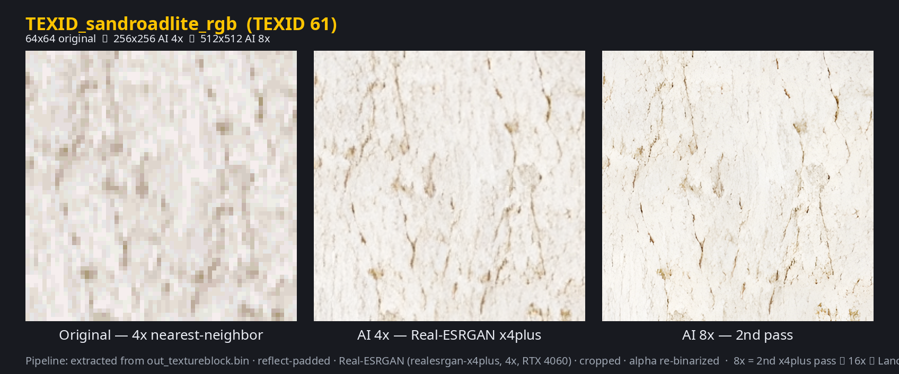
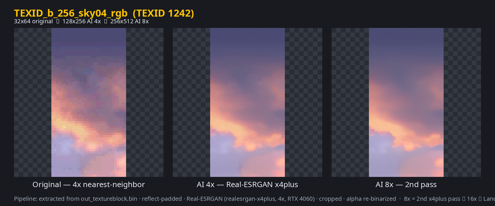
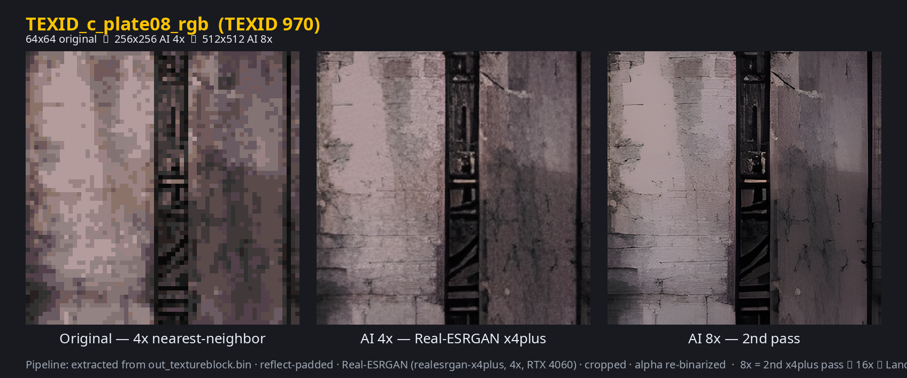
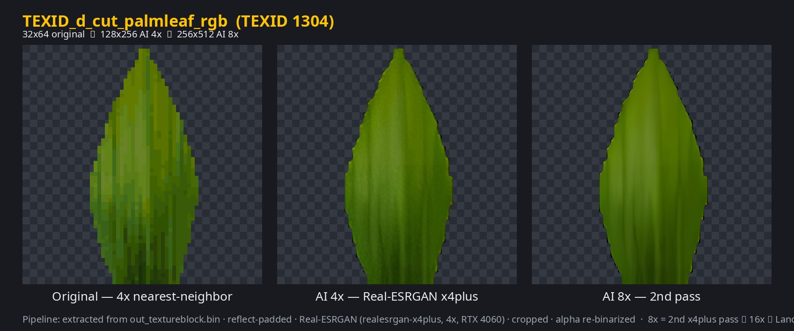
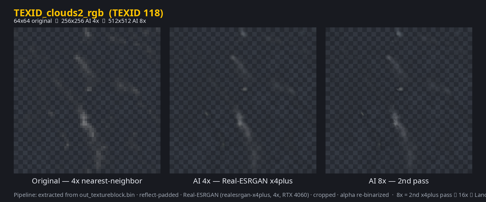
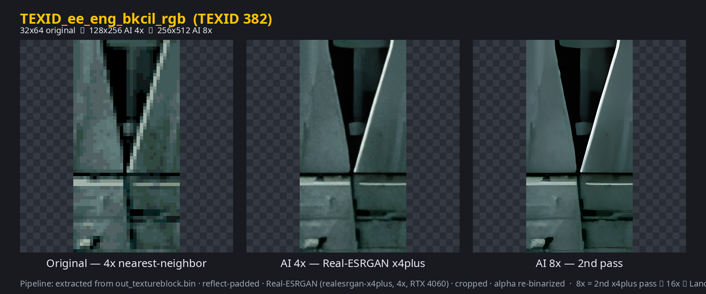
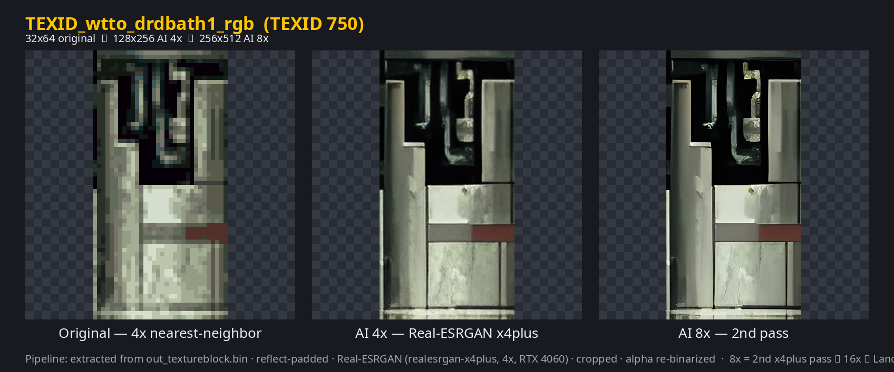
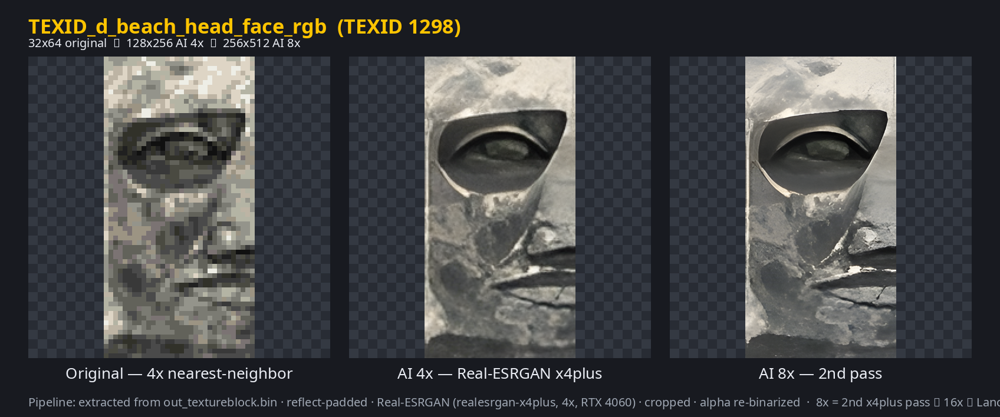
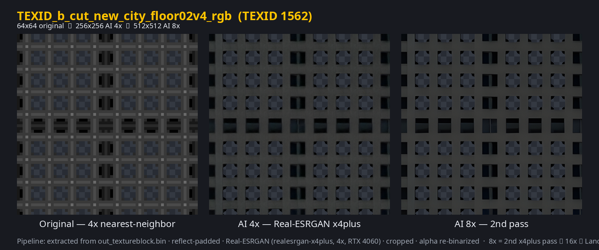

# Documentation

- [Install & features](../README.md) — quick overview, what the mod contains, installers
- [Linux / Steam Proton](LINUX_PROTON.md) — required `WINEDLLOVERRIDES` fix (F5 does nothing on Linux?)
- [Attribution & licenses](../SWRacerEnhanceMod/ATTRIBUTION.md) — every original mod/author/link/license
- [Full mod README](../SWRacerEnhanceMod/README.md) — component provenance, uninstall, optional extras
- [HD texture QA report](../SWRacerEnhanceMod/HD_TEXTURES_QA.md) — vision-LLM review of the AI textures
- [HD texture pipeline](HD_TEXTURE_PIPELINE.md) — how the 1633 AI textures were extracted, upscaled & (optionally) regenerated
- [AI-regenerated packs](../SWRacerEnhanceMod/optional/ai_textures/README.md) — optional `--ai-realistic` / `--ai-clonewars` styles
- [Upscaling, sharpening & "ray tracing"](UPSCALING.md) — what's possible (gamescope FSR/NIS, ReShade) and what isn't (DLSS, RTX Remix, real RT)

## Texture comparisons

Three-panel sheets: **left** = original game texture scaled up with nearest-neighbor,
**middle** = AI 4x upscale (Real-ESRGAN x4plus) shipped in
`SWRacerEnhanceMod/assets/replacement_textures/`, **right** = optional AI 8x
(`optional/hd_8x/`, a second x4plus pass supersampled to 8x).

### Terrain — `TEXID_sandroadlite_rgb` (TEXID 61, 32×32 → 128×128 → 256×256)

Tiling desert road surface. Note the AI version keeps the flat sandy palette and the original
mottling pattern while turning 32px blockiness into plausible gravel grain — and because the
upscaler ran on a reflect-padded tile, the texture still wraps seamlessly when the track repeats it.

### Character — `TEXID_ank_face_rgb` (TEXID 39, 32×32 → 128×128 → 256×256)

Anakin's face (used on the pod hangar / portraits). The AI pass reconstructs eyes, eyebrows and
shading from just 32×32 pixels without changing the sepia tone or the character's likeness —
this is the "generative" part of the upscale: the model hallucinates plausible skin/hair detail
that never existed at the original resolution.

All 1633 textures were spot-checked this way; the sampled reviews are in the
[QA report](../SWRacerEnhanceMod/HD_TEXTURES_QA.md).

### Sky — `TEXID_b_256_sky04_rgb` (TEXID 1242, 32×64 → 128×256 → 256×512)

Sunset/sky gradient (purple, blue, orange). The AI pass smooths the blocky banding into a
continuous gradient and blends a hard magenta seam that exists in the 32px source into the clouds,
without shifting the overall palette.

### Metal — `TEXID_c_plate08_rgb` (TEXID 970, 64×64 → 256×256 → 512×512)

Weathered hull plating with rivets and scratched paint. The upscaler reads the pixelation as
surface detail, adding plausible metal grain and scratch highlights while keeping the panel
structure and muted colours intact.

### Cutout foliage — `TEXID_d_cut_palmleaf_rgb` (TEXID 1304, 32×64 → 128×256 → 256×512)

A binary-alpha palm frond (~37% of pixels are fully transparent). The checkerboard behind the
panels shows where alpha is transparent: the upscale keeps the cutout crisp (hard alpha is
re-binarized after upscaling) so fronds don't gain soft halos.

### Clouds / smoke — `TEXID_clouds2_rgb` (TEXID 118, 64×64 → 256×256 → 512×512)

Dark swirling cloud/smoke puff used as an atmospheric effect. The AI version keeps the dark palette
and overall flow while adding sharper, plausible wisps; partial alpha (soft edges) is preserved.

### Engine metal — `TEXID_ee_eng_bkcil_rgb` (TEXID 382, 32×64 → 128×256 → 256×512)

Grey metallic mechanical panels (podracer engine housing) with triangular fins and horizontal
seams. The upscaler sharpens the low-res blocks into smoother gradients and preserves the panel
boundaries without breaking any cutout edges.

### Wall panel — `TEXID_wtto_drdbath1_rgb` (TEXID 750, 32×64 → 128×256 → 256×512)

A metallic wall panel with vertical grey plating, dark recesses and a horizontal red stripe. The AI
pass keeps the structure and colours but smooths the hard blocky lines and adds a fine grain; the
description notes it mimics high-res texture rather than inventing true geometry.

### Character face — `TEXID_d_beach_head_face_rgb` (TEXID 1298, 32×64 → 128×256 → 256×512)

A close-up of a character's face (large eye and surrounding features). The AI reconstruction adds
plausible skin/eye detail and shading from 32×64 pixels with no colour errors or broken edges —
another example of the generative side of the upscale.

### Cutout floor — `TEXID_b_cut_new_city_floor02v4_rgb` (TEXID 1562, 64×64 → 256×256 → 512×512)

A dark tiled floor with a grid of square openings (vents/windows), ~21% fully transparent. The
upscale preserves the structure and colours and adds plausible interior detail inside the squares
without hallucinating new patterns; cutout edges stay sharp.

## Optional 8x pass

The **right** panel of each sheet above is the optional 8x pack (installed with `install.sh --hd-8x`).
How it is built and its VRAM cost:
[`../SWRacerEnhanceMod/optional/hd_8x/README.md`](../SWRacerEnhanceMod/optional/hd_8x/README.md).
Regenerate every sheet with
`python3 tools/make_comparisons.py extracted final docs/comparisons final_8x`.

## Optional AI-regenerated textures

Separate from the upscaled pack, the `optional/ai_textures/` packs **generate new** textures with
SDXL-Lightning + ControlNet-Tile, guided by the originals, in two styles:

| Pack | Look | Flag |
|------|------|------|
| `realistic/` | modern photoreal PBR materials | `--ai-realistic` |
| `clonewars/` | stylised *The Clone Wars* painterly look | `--ai-clonewars` |

Each pack has **1621 textures** (~100 MB). Four-panel sheets
(**original | Real-ESRGAN 4x | AI realistic | AI Clone Wars**) are in
[`comparisons/ai/`](comparisons/ai/) (e.g. [`ai_texid_0061.png`](comparisons/ai/ai_texid_0061.png)).
Method/provenance:
[`../SWRacerEnhanceMod/optional/ai_textures/README.md`](../SWRacerEnhanceMod/optional/ai_textures/README.md)
and [`HD_TEXTURE_PIPELINE.md`](HD_TEXTURE_PIPELINE.md) §5.
